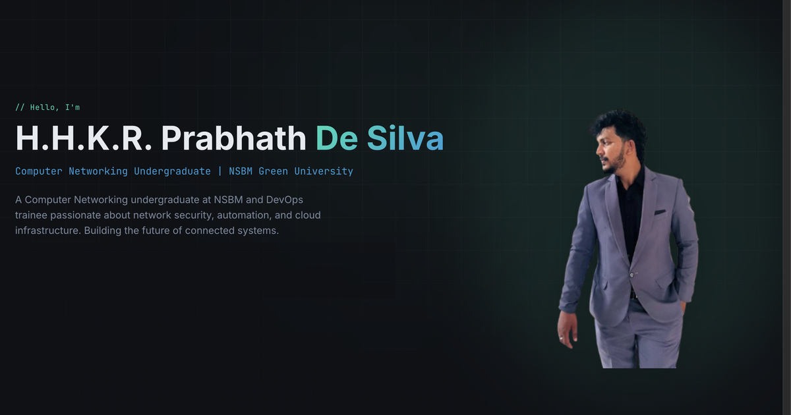

<div align="center">


# Prabhath De Silva — Portfolio

**Computer Networking Undergraduate · DevOps Trainee**

Personal portfolio website showcasing my networking, DevOps and cloud projects, experience, education and certifications.

[](https://prabhath.vercel.app/)
[](https://www.linkedin.com/in/prabhath-de/)
[](https://github.com/Prabhath-de)

<br/>



</div>

---

## About

I'm **H.H.K.R. Prabhath De Silva**, a Computer Networking undergraduate at **NSBM Green University, Sri Lanka** and a DevOps trainee. This site brings together my work in network security, automation and cloud infrastructure in one place.

## Features

- **Modern, responsive design** — works on desktop, tablet and mobile
- **Dark / Light / System theme** toggle, remembered between visits
- **Smooth animations** with Framer Motion and a typewriter hero effect
- **Sticky navbar** that highlights the section you're viewing
- **Projects gallery** with tech tags, GitHub and live-demo links
- **Timeline layouts** for work experience and education
- **Certifications** with direct links to verifiable credentials (Credly, LinkedIn Learning)
- **Volunteering** cards with auto-playing photo slideshows
- **Contact section** with email, LinkedIn, GitHub and a message form
- **SEO ready** — meta tags and Open Graph / Twitter preview image

## Sections

| Section | What's inside |
| --- | --- |
| Home | Intro, quick links to projects, credentials and LinkedIn |
| About | Background and focus areas |
| Skills | Networking, tools & technologies, scripting, professional skills |
| Projects | Home Lab Network, CI/CD with Docker, Linux Server Hardening, SSH Honeypot, Network Monitoring Dashboard, Automated Backup Script |
| Experience | DevOps Trainee at Sri Lanka Telecom, and roles at Pixel Clear (Pvt) Ltd |
| Education | BSc (Hons) in Computer Networks (NSBM), Diploma in IT (NIBM), G.C.E. A/L & O/L |
| Certifications | Aviatrix, Microsoft, Atlassian, CompTIA, Cisco and more |
| Volunteering | CSSL GenZ, Compuvate Association and other events |
| Contact | Email, social links and message form |

## Tech Stack

| Category | Tools |
| --- | --- |
| Framework | [React 18](https://react.dev/) + [TypeScript](https://www.typescriptlang.org/) |
| Build tool | [Vite](https://vitejs.dev/) |
| Styling | [Tailwind CSS](https://tailwindcss.com/) |
| UI components | [shadcn/ui](https://ui.shadcn.com/) (Radix UI) |
| Animation | [Framer Motion](https://www.framer.com/motion/) |
| Icons | [Lucide](https://lucide.dev/) |
| Hosting | [Vercel](https://vercel.com/) |

## Getting Started

**Requirements:** [Node.js](https://nodejs.org/) 18 or newer and npm.

```bash
# 1. Clone the repository
git clone https://github.com/Prabhath-de/<repo-name>.git
cd <repo-name>

# 2. Install dependencies
npm install

# 3. Start the development server
npm run dev
```

The site will be running at **http://localhost:8080**.

### Available scripts

| Command | Description |
| --- | --- |
| `npm run dev` | Start the local development server |
| `npm run build` | Create an optimised production build in `dist/` |
| `npm run preview` | Preview the production build locally |
| `npm run lint` | Check the code with ESLint |
| `npm run test` | Run the tests with Vitest |

## Project Structure

```
├── public/                  # Favicon, social preview image, robots.txt
├── src/
│   ├── assets/              # Profile photo, project and volunteering images
│   ├── components/
│   │   ├── ui/              # Reusable UI components (shadcn/ui)
│   │   ├── Navbar.tsx
│   │   ├── HeroSection.tsx
│   │   ├── AboutSection.tsx
│   │   ├── SkillsSection.tsx
│   │   ├── ProjectsSection.tsx
│   │   ├── ExperienceSection.tsx
│   │   ├── EducationSection.tsx
│   │   ├── CertificationsSection.tsx
│   │   ├── VolunteeringSection.tsx
│   │   ├── ContactSection.tsx
│   │   ├── ThemeToggle.tsx
│   │   └── Footer.tsx
│   ├── pages/               # Index (home) and 404 pages
│   ├── App.tsx
│   ├── main.tsx
│   └── index.css            # Theme colours and global styles
├── index.html
├── tailwind.config.ts
└── vite.config.ts
```

## Updating Content

Each section keeps its content in an array at the top of its component, so updating the site is simple:

- **Projects** → `src/components/ProjectsSection.tsx`
- **Experience** → `src/components/ExperienceSection.tsx`
- **Education** → `src/components/EducationSection.tsx`
- **Certifications** → `src/components/CertificationsSection.tsx`
- **Volunteering** → `src/components/VolunteeringSection.tsx`
- **Images** → add them to `src/assets/` and import them in the component

## Deployment

The site is deployed on **Vercel**. Every push to the `main` branch is built and published automatically.

To deploy your own copy: import the repository at [vercel.com/new](https://vercel.com/new) — Vercel detects Vite automatically (build command `npm run build`, output directory `dist`).

## Contact

- **Email:** [info.rashmika.prabhath@gmail.com](mailto:info.rashmika.prabhath@gmail.com)
- **LinkedIn:** [linkedin.com/in/prabhath-de](https://www.linkedin.com/in/prabhath-de/)
- **GitHub:** [github.com/Prabhath-de](https://github.com/Prabhath-de)
- **Location:** Mirigama, Sri Lanka

---

<div align="center">

© 2026 Prabhath De Silva. All rights reserved.

</div>
